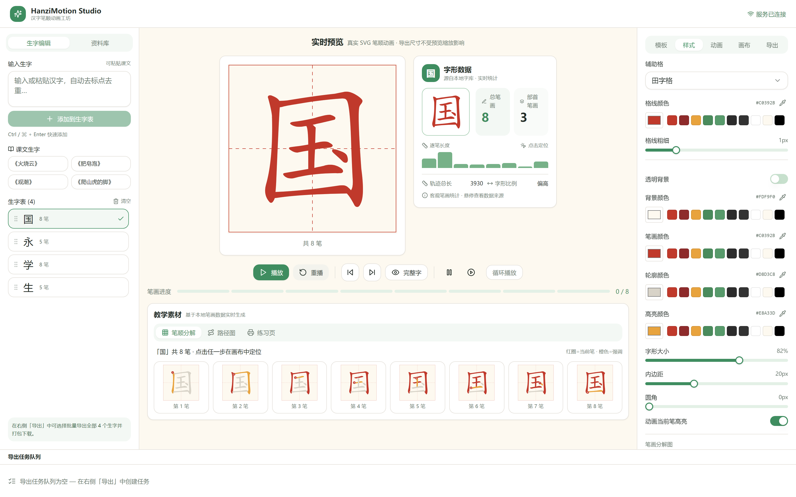
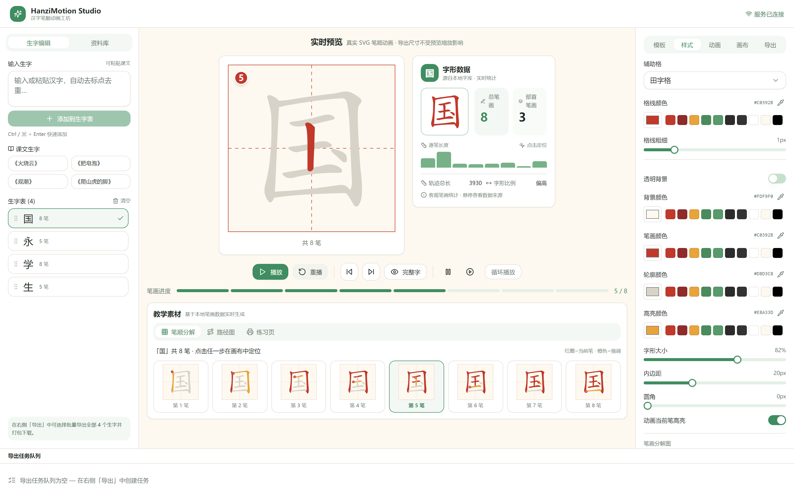
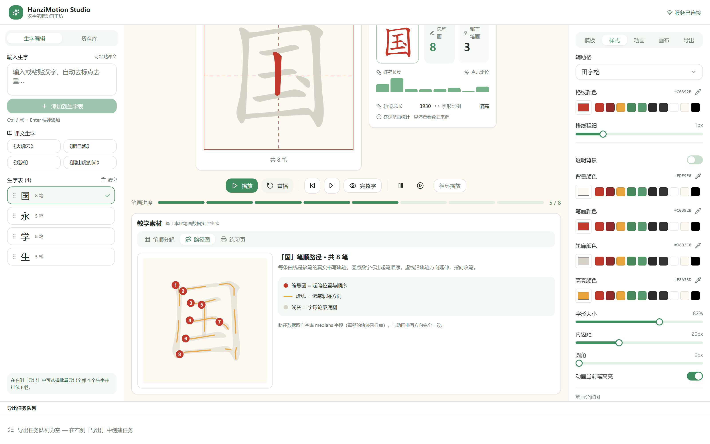
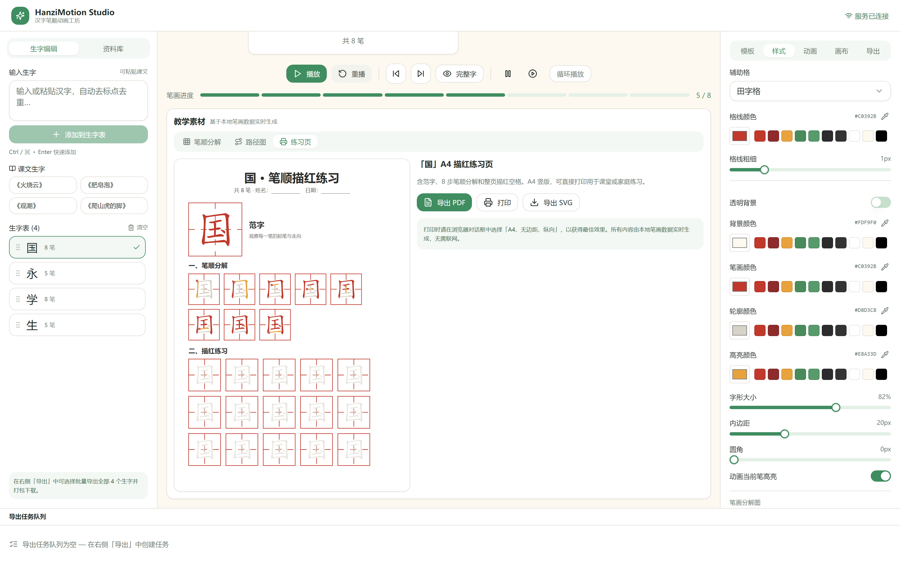

# HanziMotion Studio · 汉字笔顺动画工坊

一款面向小学语文教学的**本地 Web 应用**，把真实 SVG 笔画数据转换为逐笔书写动画，并导出为 GIF / MP4 / PNG / SVG / PDF 教学素材。无需登录、离线可用、专为制作 PPT/WPS 课件素材设计。

---

## ✨ 核心特性

- **真实笔顺动画**：基于 Hanzi Writer + hanzi-writer-data 的真实 SVG 笔画路径，绝非字体模拟。
- **完整编辑三栏工作台**：左侧生字管理、中间实时预览画布、右侧样式/动画/导出配置、底部任务队列。
- **逐笔精确控制**：播放 / 重播 / 上一笔 / 下一笔 / 暂停 / 循环，实时笔画进度。
- **教学样式**：田字格 / 米字格 / 无格，颜色、透明度、字形大小、边距全可调，4 套内置模板。
- **所见即所得导出**：导出与预览使用同一套渲染配置；帧数由动画真实进度驱动，**复杂汉字绝不被固定时长截断**。
- **批量处理**：多字批量导出并**自动打包为一个 ZIP**，任务队列 + 并发限制 + 失败重试。
- **笔画分解图**：逐笔步骤图（已写笔实心、当前笔强调色、其余轮廓）+ 总览图，**当前笔起点标注红圈白字序号**，PNG/SVG 打包下载，适合备课打印。
- **序号标注与当前笔强调**：分解图每步在当前笔起点标出笔画序号（参考 hanzistroke.com 教学设计），当前笔以强调色突出；两个开关在「样式」面板，画布预览同步显示序号徽章。
- **教学素材三件套**（中央区「教学素材」标签）：① **笔顺分解墙**——每笔一个小格、点击即在画布定位到该笔；② **笔顺路径图**——用 medians 画真实运笔轨迹 + 起笔序号 + 图例；③ **A4 描红练习页**——范字 + 逐笔分解 + 描红空格，可打印、导出 SVG 或**导出矢量 PDF**（所见即所得，中文清晰）。全部由本地笔画数据实时生成，零外部依赖。
- **中央预览自适应收缩**：实时预览画布固定显示为 340px，避免中央区过大；导出仍使用你设置的画布尺寸，二者互不影响。
- **字形数据卡**：画布旁展示总笔画、部首笔画（点击可高亮迷你字形中的部首笔画）、逐笔长度条（点击定位画布到该笔）、轨迹总长与字形比例——全部由 medians/radStrokes 客观派生，零外部数据、不做笔画类型或结构推断。数据卡与画布共用同一份字库数据，切字无不同步。
- **资料库管理**：生字项目、自定义模板、导出历史的保存 / 加载 / 复制 / 重新导出 / 删除（SQLite 持久化）。
- **完全本地**：数据存 SQLite，内置 9534 字全量离线字库，无账号、无网络依赖。
- **容器化部署**：一条 `docker compose up` 即可启动完整应用。

---

## 🖼️ 界面预览

> 以下截图来自实际运行界面（以「国」字为例，8 笔），非设计稿。

### 主工作台

三栏布局：左侧生字管理与课文预设、中间实时预览画布 + 字形数据卡、右侧样式/动画/导出配置。画布下方是逐笔播放控制与分解墙。



### 笔顺分解墙 · 点击联动

每一笔一个小格。点击任一格，画布立即定位并高亮对应笔画（下图为点击第 5 笔，进度 5/8，分解墙对应格呈选中态）。



### 笔顺路径图

用 `medians` 真实运笔轨迹绘制，红圈数字标出起笔顺序，配图例说明。



### A4 描红练习页

范字 + 逐笔分解 + 描红空格三段式排版，可直接打印、导出 SVG 或矢量 PDF。



---

## 📋 环境要求

| 依赖 | 版本 | 状态检查 |
|---|---|---|
| Node.js | ≥ 18（推荐 22） | `node --version` |
| Python | ≥ 3.10（推荐 3.13） | `python --version` |
| FFmpeg | 任意含 libx264 的构建 | `ffmpeg -version` |
| Chromium | Playwright 自动安装 | 安装脚本自动完成 |

> 本机开发环境已确认：Node 22.22.2 / Python 3.13.12 / FFmpeg 9.0.2 全部就绪。

---

## 🚀 快速启动

### 方式一：Docker 一键启动（推荐，需 Docker Desktop）

```bash
docker compose up -d --build
```

浏览器打开 **http://localhost:8100**。容器已内置 Node 构建产物、Python 依赖、Chromium、FFmpeg 与中文字体，一个端口同时提供 UI 与 API。数据通过 `studio_storage` 卷持久化，容器重建不丢失。

停止：`docker compose down`；查看日志：`docker compose logs -f`。

> 需先启动 Docker Desktop（确保 daemon 运行）。配置已通过 `docker compose config` 校验。

### 方式二：本地开发启动

以下为不依赖 Docker 的本地开发方式。

#### 1. 安装前端依赖

```bash
cd frontend
npm install
cd ..
```

#### 2. 安装后端依赖

```bash
python -m pip install -r backend/requirements.txt
python -m playwright install chromium
```

#### 3. 汉字笔画数据（已内置全量字库）

项目**已内置 9534 个常用汉字的真实笔画数据**（前后端各一份，完全离线，无需下载）。直接跳到第 4 步启动即可。

如需补充极生僻字（内置字库未覆盖），可联网补充：

```bash
python backend/scripts/fetch_chars.py 蘡 齉  # 指定任意生僻字
```

> 说明：内置字库源自 hanzi-writer-data（9534 个 CJK 基本区汉字），覆盖小学全部生字及日常用字。`fetch_chars.py` 仅用于补充内置字库之外的罕见字。

#### 4. 启动服务（两个终端）

**终端 A — 后端（8100 端口）：**
```bash
cd backend
python -m uvicorn main:app --host 127.0.0.1 --port 8100
```

**终端 B — 前端（5173 端口）：**
```bash
cd frontend
npm run dev
```

浏览器打开 **http://127.0.0.1:5173** 即可使用。

> 端口说明：默认后端 8100（因为常见的 8000 端口常被其他服务占用）。如需改端口，同步修改 `frontend/vite.config.ts` 中 proxy 的 target。

---

## 📖 使用流程

1. **添加生字**：左侧输入框输入或粘贴课文 → 点「添加到生字表」（自动去标点、去重、校验字库）。也可一键载入内置课文生字。
2. **选择编辑字**：点击生字卡片切换当前编辑字。
3. **预览动画**：中间画布点「播放 / 重播 / 上一笔 / 下一笔 / 循环」控制；进度条显示当前笔画。
4. **调整样式**：右侧切换「模板 / 样式 / 动画 / 画布」标签，所有修改实时同步预览。
4b. **查看教学素材**：中央区「教学素材」可切「笔顺分解」（点击小格定位到该笔）、「路径图」（运笔轨迹）、「练习页」（打印 / 导出 A4 描红 SVG / 导出矢量 PDF，均从底部导出队列下载）。
5. **导出素材**：右侧「导出」标签选格式（GIF/MP4/PNG/SVG）和范围。单字直接导出；**批量导出自动打包为一个 ZIP**，一次下载。底部队列查看进度、下载、失败重试。
6. **笔画分解图**：右侧「导出」标签底部选 PNG/SVG，点「导出分解图」，得到逐笔步骤图 + 总览图的 ZIP。想调整序号标注 / 当前笔强调色，先在「样式」标签的「笔画分解图」区开关（默认都开启）。
7. **资料库管理**：左侧切到「资料库」标签，可保存/载入生字项目、保存/应用自定义模板、查看导出历史并一键重新导出。

---

## 🏗️ 项目结构

```
hanzi-motion-studio/
├── Dockerfile / docker-compose.yml / .dockerignore   # 容器化部署
├── start.bat                # Windows 本地一键启动脚本
├── PRD.md / ARCHITECTURE.md / TASKS.md / THIRD_PARTY_NOTICES.md
├── docs/OPEN_SOURCE_RESEARCH.md   # 开源项目源码级研究
├── frontend/                # React + Vite + TS + Tailwind + Zustand
│   ├── public/hanzi/        # 前端字库（离线）
│   ├── render.html          # 后端渲染采集用的页面
│   └── src/
│       ├── components/HanziCanvas.tsx   # 可复用动画画布
│       ├── components/LibraryPanel.tsx  # 资料库管理面板
│       ├── lib/exportDispatcher.ts      # 导出调度（单字/ZIP/分解图）
│       ├── hooks/useHanziWriter.ts      # 动画控制（真实 API）
│       └── store/useStudioStore.ts      # 状态中心
└── backend/                 # FastAPI + SQLite + Playwright + FFmpeg
    ├── main.py
    ├── app/services/        # render_capture / encoder / decompose / zip_bundle / task_manager
    ├── app/api/             # chars / export(batch,bundle,decompose) / projects
    ├── data/hanzi/          # 后端字库（离线）
    └── tests/               # 自动化测试
```

详见 `ARCHITECTURE.md`。

---

## 🧪 测试

```bash
# 后端服务单元测试（无需启动服务）
python -m pytest backend/tests/test_services.py -q

# 端到端导出测试（验证 PNG/GIF/MP4/SVG 真实可用）
python backend/tests/test_export_e2e.py

# API 集成测试（需后端运行在 8100）
python backend/tests/test_api_integration.py

# 新功能测试：ZIP 打包 / 分解图 / 项目模板历史 CRUD（需后端运行在 8100）
python backend/tests/test_new_features.py

# UI 冒烟测试（需前端 5173 + 后端 8100）
python backend/tests/test_ui.py

# 字库完整性校验（校验 strokes/medians/radStrokes 结构）
python backend/scripts/verify_char_data.py
```

---

## 📚 开源项目研究

本项目的动画引擎、字库与导出方案在动工前经过三个开源仓库的源码级调研（研究记录见 `docs/OPEN_SOURCE_RESEARCH.md`）：

- **Hanzi Writer**（MIT）：复用其逐笔动画算法与 SVG 渲染；逐笔进度由其 `animateStroke` 串联实现（官方 `animateCharacter` 无进度回调）。
- **Hanzi Writer Data**（Arphic Public License）：复用 9575 字真实笔画数据；离线加载。
- **Chinese-Stroke-Order-Generator**（MIT）：借鉴其离线请求拦截、原子写入、批量并发实践；未采纳其固定时长采集（会截断）与 Puppeteer（改用与 FastAPI 同语言的 Playwright）。

研究结论已同步到 `ARCHITECTURE.md` 与 `TASKS.md`。三个仓库的源码克隆保存在 `references/` 仅供分析，不参与运行。

---

## ⚠️ 常见问题

- **导出卡住 / 失败**：确认 FFmpeg 在 PATH 中、Chromium 已安装（`python -m playwright install chromium`）。
- **某字显示"缺数据"**：该字是内置 9534 字之外的极生僻字，运行 `python backend/scripts/fetch_chars.py <字>` 联网补充（需联网）；若已联网仍失败，说明该字不在 hanzi-writer-data 数据集中，暂无笔画数据可用。
- **后端未连接提示**：动画预览不依赖后端可正常使用；导出需后端运行。
- **pip 环境错配**：若机器有多个 Python，务必用 `python -m pip` 而非裸 `pip`。

---

## 📄 开源许可证

- Hanzi Writer 代码：MIT（Copyright © 2014 David Chanin）
- 汉字笔画数据：Arphic Public License（源自 Make Me A Hanzi）
- 详见 `THIRD_PARTY_NOTICES.md`
